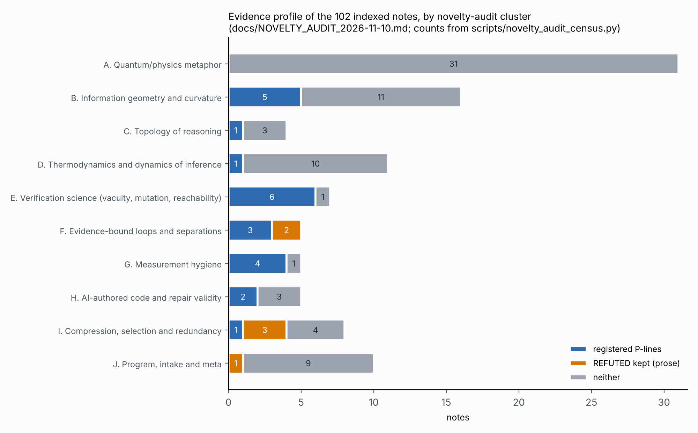

# Novelty audit of the note series — 2026-11-10

**What this is.** A repository-wide prior-art pass over 102 discovered note files, grouped into ten
clusters, with a verdict per cluster on where the program's defensible novelty does and does not
live. Per the house rule, candidate ideas arrive here as **questions to kill**, not findings:
this document certifies nothing as novel. A verdict of "possibly distinctive" means a targeted
search did not kill it, not that an exhaustive one would not.

**Method and its limits.** Cluster assignment and counts come from
`scripts/novelty_audit_census.py` (its output is pasted verbatim below; `--selftest` proves the
census can detect a missing or doubly-assigned file). Prior-art evidence comes from targeted web
searches run on 2026-11-10 at cluster level — roughly one search per cluster, aimed at each
cluster's strongest claim — plus the prior-art sections the later notes already carry. This is
**not** an exhaustive literature review, no paper was read in full for this audit, and cluster
assignment is one reader's judgment: several notes straddle clusters, and the census makes the
assignment auditable rather than correct.

## Census (verbatim output of `python scripts/novelty_audit_census.py`)

```
indexed note files discovered: 102
  earlier series (NNN_*): 53; later series (noteNNN_*): 49
reference script files: 31 (number-based matching to notes is unreliable here; numbers collide, so scripts are counted, not attributed)
notes containing 'REFUTED': 15
notes with at least one registered 'P<n>' line: 23
cluster A. Quantum/physics metaphor: 31 notes
cluster B. Information geometry and curvature: 16 notes
cluster C. Topology of reasoning: 4 notes
cluster D. Thermodynamics and dynamics of inference: 11 notes
cluster E. Verification science (vacuity, mutation, reachability): 7 notes
cluster F. Evidence-bound loops and separations: 5 notes
cluster G. Measurement hygiene: 5 notes
cluster H. AI-authored code and repair validity: 5 notes
cluster I. Compression, selection and redundancy: 8 notes
cluster J. Program, intake and meta: 10 notes
assigned to clusters: 102; discovered but unassigned: 0
PROBLEMS: 0
```

**Index-scope discrepancy (not concealed).** The census finds 102 note files, but the generated
`NOTES_INDEX.md` currently lists 101. The difference is
`notes/note048_grok_contribution_manifesto.md`: the census accepts `notes/noteNNN_*.md`,
whereas `scripts/make_index.py` currently does not. This audit's 102-file count is **not**
a claim that all 102 are indexed or independently verified. Reconciling the index filename
pattern and the note's classification remains a separate tracked correction; no Verified
count is increased here.



*Figure: drawn by `scripts/generate_novelty_map.py` from the census's own cluster map and
regexes. A note counts once: in the P-line segment if it registers predictions, else in the
REFUTED segment if it keeps a refutation in prose, else "neither".*

## Cluster verdicts

### A. Quantum/physics metaphor (31 notes) — established adjacent fields; no claim survives as novel

The largest cluster: quantum formalisms, holography, emergent spacetime, topoi and category
theory applied to reasoning, almost all from the earlier series and almost all labeled
Speculative or stronger. Applying quantum probability to cognition is an established research
program with a standard textbook —
[Busemeyer & Bruza, *Quantum Models of Cognition and Decision*, Cambridge UP](https://www.cambridge.org/core_title/gb/423213)
— and the holographic/AdS-CFT and emergent-gravity framings are borrowed wholesale from physics.
As written, most of these notes register no predictions (the census confirms only 23 of 102 notes
repo-wide carry a `P<n>` line, nearly all in the later series), so there is no falsifiable claim
to assess for novelty. **Verdict: the cluster's value is a labeled creative corpus, not claims.
Any future note here must first say what Busemeyer-Bruza-style quantum cognition does *not*
already say.** Exception worth naming: `note046` (Page–Wootters) and `note047` ([[5,1,3]] code)
ship runnable reference code for known physics — correct pedagogy, deliberately not claimed as
new.

### B. Information geometry and curvature (16 notes) — known field; the refutations are the contribution

Information geometry in learning is Amari's field; discrete Ricci curvature on graphs and its
relation to over-smoothing/over-squashing in GNNs is active mainstream work (e.g.
[Nguyen et al., ICML 2023](https://proceedings.mlr.press/v202/nguyen23c.html), and a 2026 ICLR
paper [questioning discrete curvature as the right lens](https://iclr.cc/virtual/2026/poster/10009576)).
The program's own results here are mostly negative and kept: note054/note055 (curvature-based
compute allocation loses to uniform), note056 (the curvature estimator reports 54 million where
the true value is bounded), note053 (soft-HyperDGA P1 refuted). **Verdict: the geometric claims
are not novel; the preregistered negative results about what curvature does *not* buy on these
instruments are honest, small, and the cluster's real product.**

### C. Topology of reasoning (4 notes) — field exists; one live question

TDA on transformer internals is an active area (e.g.
[xPerT](https://arxiv.org/html/2410.14193v2) and
[topological analyses of attention/context memory](https://arxiv.org/pdf/2608.09997)).
note041 (new series) asks a narrower question — do Betti numbers of a reasoning chain's point
cloud count "independent ideas"? — and still has registered predictions. **Verdict: the tools
are standard; the specific operationalization in note041 is a live, killable question. Before
running it, search specifically for persistent homology applied to chain-of-thought text
embeddings, not just to attention.**

### D. Thermodynamics and dynamics of inference (11 notes) — term collision found

"Thermodynamic depth" (note033) is an established complexity measure —
[Lloyd & Pagels 1988, discussed critically in Crutchfield & Shalizi](https://arxiv.org/abs/cond-mat/9808147)
— and the free-energy framing of note043 sits beside Friston's free-energy principle, one of the
most-cited frameworks in theoretical neuroscience. **Verdict: no novelty in the framings; note033
should carry a line acknowledging the Lloyd–Pagels term or rename its quantity, since using an
established term for a different quantity is the kind of collision this repo's method exists to
catch.** The governance notes (050, note029) are design documents, not claims.

### E. Verification science (7 notes) — the program's center of gravity; novelty is in the instruments, not the concepts

The concepts have deep prior art, which the notes themselves found and kept: vacuity is
Kupferman & Vardi 1999 (note058's own finding — the series' best prior-art kill), mutation-score
denominators touch the known equivalent-mutant problem, and reachability is classic program
analysis. What the searches did **not** find killed: the small preregistered *empirical*
instruments applied to AI-authored verification code — note052's two-type taxonomy measured on a
real estate, note062's self-audit (do the notes' numbers appear in their own code's output?),
note060's reachability denominator. **Verdict: concepts known; the instrument-plus-measurement
pairs are possibly distinctive. The strongest open candidate remains the one on record since
July: *across N repos, X% of verification entry points have no fail path, and is the rate higher
in AI-authored code than in a human-written control?* — a controlled comparison that none of the
targeted searches surfaced.**

### F. Evidence-bound loops and separations (5 notes) — crowded 2026 field; one possibly distinctive angle

Goodhart effects, reward hacking, eval contamination and judge leakage are heavily worked
territory, now including practitioner literature on
[Goodhart's law in LLM eval suites](https://tianpan.co/blog/2026-04-14-goodharts-law-in-your-llm-eval-suite)
and [eval-set contamination via production leakage](https://tianpan.co/blog/2026-04-23-eval-set-contamination-production-leakage-gold-labels).
note064's specific move — enumerate *which separations* in an outcome-feedback loop prevent
*which dependency*, with registered predictions per cell — did not surface in the targeted
search. **Verdict: the problem is not novel; the separation-lattice instrument is possibly
distinctive and worth a dedicated prior-art search before any claim strengthens.**

### G. Measurement hygiene (5 notes) — known genre; two concrete original data points

That benchmarking produces wrong data without obvious error is literally the title of
[Mytkowicz et al., ASPLOS 2009](https://sape.inf.usi.ch/publications/asplos09), and note072
already frames "speedup is a surface" against cited prior art. JSON number interoperability is
standardized ground ([RFC 8785](https://www.rfc-editor.org/rfc/rfc8785) exists because parsers
diverge). **Verdict: the genre is established; note077/note078's specific measured divergences
(a stable JSON conversion changing numeric values; equal decimal literals parsing to infinity or
zero in SQLite) are small concrete data points of the known class, honestly scoped. note079's
sim-to-real episode audit is an instance of a known gap, not a new method.**

### H. AI-authored code and repair validity (5 notes) — note073's missing prior-art search is answerable now

note073 states "a prior-art search for that protocol has not been done." The automated-program-
repair literature is directly on point: patch overfitting and plausible-vs-correct patches are a
named problem with a decade of work — e.g.
[Qi et al.-era analyses](https://web.cs.umass.edu/publication/docs/2015/UM-CS-2015-007.pdf),
[patch-correctness prediction](https://arxiv.org/pdf/2107.13296), and
[Petke et al. 2024 on the practical magnitude of patch overfitting](https://gpbib.cs.ucl.ac.uk/gp-html/Petke_2024_FSEIVR.html).
"Passing the tests is not removing the defect" is this field's founding observation. **Verdict:
note073's core framing is established prior art and the note should take the citations in as a
dated addition; what may remain distinctive is applying its repair-validity protocol to
*verification code* (the repair fixes the checker, not the checked) and note074's CST-001 causal
design, whose own prior-art section already marks the gap honestly.**

### I. Compression, selection and redundancy (8 notes) — mixed; refutations kept

NCD (038) is Cilibrasi–Vitányi's method applied, not claimed as new. note039/note040/note045
form a small preregistered line on redundancy and survival under mutation with refutations kept.
**Verdict: concepts known (MDL, neural redundancy); the specific mutation-survival instruments
are the same "possibly distinctive instrument" class as cluster E.**

### J. Program, intake and meta (10 notes) — not claims

Literature intakes, handoffs, manifestos and the program's founding question. Nothing here
asserts novelty; nothing to kill.

## Synthesis — where the defensible novelty actually lives

1. **Not in the theory.** Every theoretical framing in clusters A–D has a named adjacent field,
   and the honest status labels already say so. The audit found one term collision to fix
   (note033 vs Lloyd–Pagels) and one missing citation set to take in (note073 vs APR
   overfitting).
2. **In the instruments applied to AI-authored artifacts.** The preregistered
   instrument-plus-measurement pairs of clusters E/F/G/I — vacuity rates, number self-audits,
   reachability denominators, separation lattices, mutation-survival — target a corpus (AI-
   authored verification code, measured on-device, failures kept) that the targeted searches did
   not find measured elsewhere. These stay "possibly distinctive" until each gets its own
   dedicated search.
3. **In the corpus itself.** A 102-note research record with preregistration, 15 notes carrying
   kept refutations, named AI co-authors and device-verified numbers is itself an unusual
   artifact; its value does not depend on any single claim being novel.

## Questions to kill next (feeding new notes)

- **Q1 (cluster E, strongest):** across N public repos, what fraction of verification entry
  points cannot fail, and is the rate different in AI-authored code vs a human-written control?
  Kill-search: mutation testing / test-smell corpus studies on LLM-generated tests.
- **Q2 (cluster C):** do Betti numbers of embedded reasoning chains track independent-idea
  counts better than cluster counts (the simplest rival, M14)? Kill-search: TDA on
  chain-of-thought embeddings specifically.
- **Q3 (cluster F):** does any published taxonomy map separation mechanisms to the dependency
  each prevents, as note064's lattice does? Kill-search: data-governance / eval-isolation
  taxonomies.
- **Q4 (cluster D, hygiene):** rename or annotate note033's "thermodynamic depth" after reading
  Lloyd–Pagels and Crutchfield–Shalizi's critique.

## Doors deliberately left open

The per-cluster verdicts above rest on one targeted search each. A dedicated per-claim search
for Q1–Q3, and a full read of the five APR papers for note073, are registered here as unrun.

---

**Provenance (M13):** audit designed, census written and run (container, x86_64, Python 3.13 —
not device-verified; the census reads files and runs no experiments), searches run and document
drafted by Claude (Anthropic, Fable 5), 2026-11-10, under Chad Holland's direction to "novelty
analyze the entire repository." Human validation: not performed. Human responsibility: Chad
Holland. Review level: direction only. Cluster assignment is Claude's judgment; the census makes
it checkable, not correct.
