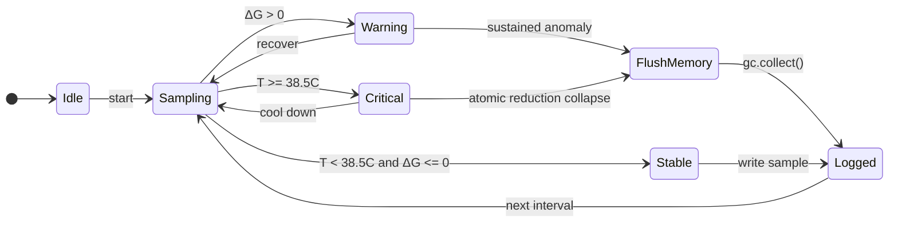

# Exp #001 State Machine

## Diagram

> **Documentation correction (2026-10-14; W9):** This is a conceptual state machine, not an execution trace or verified physical recovery controller. The current `experiments/exp001_entropy_monitor.py` uses `gc.collect()` only in the critical-temperature branch, not on warning, and does not implement an `ATOMIC_REDUCTION_COLLAPSE` or prove topological state changes. Sensor failure currently falls back to a fixed nominal temperature, so no fail-closed acquisition behavior is demonstrated.
