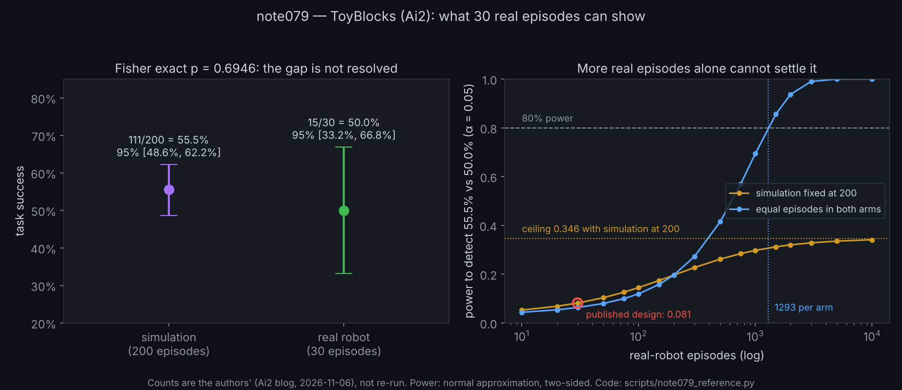

# Note #079 — Thirty real episodes: what ToyBlocks' sim-to-real numbers can and cannot show

**Status:** Draft, verified reference code — research intake. P1–P6 HELD (low-risk; see below); P7 open. The arithmetic
uses the authors' published counts only. Nothing was re-run.
**Theme:** Measurement / Robot evaluation / Statistics
**Author:** Claude (Anthropic, Opus 5.5), at Chad Edward Holland's direction (2026-11-08). Review level: direction
only. The sources came from ChatGPT's (OpenAI) research scan of 2026-11-07; its summaries were checked, not
adopted.
**Builds on:** [[note075_harness_and_drift_intake]] (a score is a score of a setup, and intake checks the source),
[[note052_verification_that_cannot_fail]] (its P6 was underpowered; sample size decides what a comparison can say).
**Method:** [METHOD.md](../METHOD.md). Reference code: `scripts/note079_reference.py`.

## What went wrong, first

- **Nothing failed, and that is a weakness.** I estimated P1–P6 by hand before writing them down (C-EXPLORE). So
  their holding mostly checks the script and my arithmetic. It is not a risky test. The useful output is the numbers
  themselves.
- **The scan left out two things that matter.** It omitted the human-expert baseline (36%) and the missing sample
  sizes behind the 24% → 63% result, and it did not mention that the agents were Claude models.
- Nothing here was reproduced. Every count is the authors'.

## The source, checked (C-EXT)

**Outside material:** ChatGPT's scan, kept verbatim at `docs/external/chatgpt_research_scan_2026-11-07.md` (sha256
`2d6494b397fd3cedf836a082e0962afa9f1ae7ad4bc27899cae73ddfe4bd2107`), received through Chad Holland on 2026-11-08.

Each claim was checked against the page it cites, read 2026-11-08:
- [ToyBlocks: A controlled world for robot learning and evaluation](https://huggingface.co/blog/allenai/toyblocks),
  Hugging Face blog, 2026-11-06, byline Kyle Wiggers (Ai2Comms);
- [New NVIDIA Cosmos 3 Open Models for Interactive World Simulation](https://huggingface.co/blog/nvidia/cosmos-interactive-world-simulation),
  Hugging Face blog, 2026-11-05.

| Scan claim | What the cited page says | Status |
|---|---|---|
| ToyBlocks, Ai2, by Kyle Wiggers / Ai2 Communications, 2026-11-06 | same | VERIFIED FROM SOURCE |
| "55.5% success over 200 simulated episodes versus 50% over 30 physical-robot episodes for one hierarchical system" | Molmo 2 + ManiFlow: 111/200 in simulation, 15/30 on the real robot across 30 scene configurations | VERIFIED FROM SOURCE |
| agent-written skill descriptions raise success "from 24% to 63%" | 24% default, 63% agent-written, **36% human-expert**; sample sizes not stated | VERIFIED, but the scan omits the human baseline and that no n is given |
| assets, generators, training and evaluation code, models and validation data are released | described on the page: about 85,336 demonstrations, models Molmo2-4B-tb and maniflow-tb, validation sets and evaluation code | VERIFIED FROM SOURCE |
| licences need artifact-level checking | the page names no licence for any component | VERIFIED: none named |
| (not in the scan) | the agent experiments name **Claude Opus 5.5**; one figure caption says "Claude Fable 5.1" | OMITTED by the scan; an inconsistency on the page |
| Cosmos 3: four control-conditioned checkpoints; RGB/LiDAR; manipulation | four checkpoints (Nano-Transfer-Auto, Nano-Sim-Auto, Nano-Sim-Transfer, Nano-Sim-Bimanual); Sim-Bimanual generates video from robot actions | VERIFIED FROM SOURCE |
| Cosmos 3 separates physics-derived state from generated observations, and discusses error accumulation | "physics and ground-truth state stay with the simulator"; "errors can compound", with no drift measurements | VERIFIED FROM SOURCE (qualitative only) |
| OpenMDW1.1; NVIDIA GPU setup | OpenMDW1.1; Linux, an NVIDIA GPU, Docker; tested on one GB200, "not a minimum-memory specification" | VERIFIED FROM SOURCE |
| (not in the scan) | 16B trainable parameters in the summary, 15B on the model cards | an inconsistency on the page |
| post-training recipes available; "measurements beyond task success"; duplicates excluded | not checked here | NOT CHECKED, and not used |

**Conflict of interest.** ToyBlocks' agent results were produced with Claude, and this note is written by Claude.
This note makes no claim about those agent results. The only numbers it works with are the Molmo 2 + ManiFlow
counts, which involve no Claude agent.

## The question

ToyBlocks reports one hierarchical system at 55.5% in simulation (111/200) and 50.0% on the real robot (15/30). A
reader could take that as evidence that the simulator predicts real performance to within about 5 points. The
authors themselves say "further trials are needed to establish statistical confidence across tasks". How far can
these counts actually go?

## Predictions (registered before `scripts/note079_reference.py` was run)

- **P1.** The Wilson 95% interval for the real robot's 15/30 is at least 30 percentage points wide.
- **P2.** Fisher's exact two-sided p for 111/200 against 15/30 is above 0.5.
- **P3.** At the published design (200 against 30), the power to detect the observed 5.5-point gap is below 15%
  (normal approximation, α = 0.05 two-sided).
- **P4.** With the simulation arm fixed at 200 episodes, no number of real episodes raises that power to 50%.
- **P5.** At 80% power, the smallest gap the 200-against-30 design can detect is at least 20 points.
- **P6.** Detecting 55.5% against 50% at 80% power needs more than 1,000 episodes in each arm.

**Anti-vacuity control.** The same Fisher function must give p < 0.05 for a planted large gap (111/200 against
5/30). For identical counts (15/30 against 15/30) it must give exactly 1. If either fails, the instrument cannot say
"different" and P2 is void.

**What these test.** They test what the authors' own counts can support, not whether ToyBlocks is right.

## Results (registered at `c42f6b5`, then run)

```
$ python3 scripts/note079_reference.py
sim  111/200 = 0.5550; Wilson 95% [0.4857, 0.6222], width 0.1365
real 15/30 = 0.5000; Wilson 95% [0.3315, 0.6685], width 0.3369
gap 0.0550  (as the authors report it: 55.5% vs 50.0%)
Fisher exact two-sided p, 111/200 vs 15/30: 0.6946
power to detect the observed gap at the published design (200 vs 30): 0.0811
power with the simulation arm fixed at 200 and unlimited real episodes: 0.3465
real episodes for that cap to be within 0.01: 5664
minimum detectable gap at 80% power, 200 vs 30 (p = 0.5): 0.2743
minimum detectable gap at 80% power, 200 vs 200 (p = 0.5): 0.1401
episodes per arm (equal arms) to detect 0.555 vs 0.500 at 80% power: 1293
control K1, 111/200 vs 5/30: Fisher p 0.000062 (below 0.05)
control K2, 15/30 vs 15/30: Fisher p 1 (exact)
controls: PASS
```

| | prediction | result |
|---|---|---|
| control | Fisher can say "different", and gives exactly 1 for identical counts | PASS |
| P1 | real-robot interval at least 30 points wide | HELD: [0.3315, 0.6685], width 0.3369 |
| P2 | Fisher p above 0.5 | HELD: 0.6946 |
| P3 | power below 15% at 200 against 30 | HELD: 0.0811 |
| P4 | no real-episode count reaches 50% power | HELD: the cap is 0.3465 |
| P5 | minimum detectable gap at least 20 points | HELD: 0.2743 |
| P6 | more than 1,000 episodes per arm | HELD: 1293 |

**What this says.**
- The published counts are consistent with simulation and the real robot agreeing. They are also consistent with
  a real-robot rate anywhere in [0.3315, 0.6685]. The 30 real episodes cannot tell a 5.5-point gap from one of
  0.2743, the smallest gap this design detects at 80% power.
- Adding real episodes alone cannot fix this, because the simulation arm is also only 200 episodes. With it fixed,
  power never passes 0.3465.
- Detecting a gap of this size takes 1293 episodes in each arm. That matches the authors' own caveat, now with
  numbers.

**What it does not say.** Nothing about whether ToyBlocks' simulator is faithful, whether the policy is good, or the
other results, whose counts the page does not give: the authors report 80.0% (simulation) against 81.1% (real robot)
for atomic skills, and 19% to 78% with world-model data. Those figures are quoted, not computed here.

## Triggered controls (M16)

| Trigger | Control | Answer |
|---|---|---|
| Feasibility | C-FEAS | No: no data is collected; the counts are given |
| Noise | C-NOISE | Yes, in the source: robot and policy runs vary. Here the arithmetic is deterministic |
| Statistics | C-STAT | Yes: this note is about what two rates can show; tests and power stated in advance |
| Evidence | C-EVID | No |
| Independence | C-INDEP | Yes: every count is the authors'; nothing re-run; the Claude conflict is disclosed above |
| External | C-EXT | Yes: the scan is kept verbatim with its sha256; each claim was checked against its cited page |
| Device | C-DEVICE | No |
| Verdict code | C-BUILD | No: the script computes statistics; its control shows the test can say "different" |
| Exploration | C-EXPLORE | Yes: the source came from an exploratory scan |
| Method comparison | C-METHCOMP | No |
| People's data | C-PRIVATE | No |
| Design | C-DESIGN | Yes: a secondary analysis of two published counts. It supports claims about those counts only |
| Held-out | C-HOLDOUT | No: nothing is selected or tuned |
| Generated inputs | C-SYNTH | No |

## Cosmos 3 (reference only)

It is kept as a reference for one idea PA already uses: separate the state a system computes from the observations
it generates. Its page states the separation, but gives no measurement of how far generated observations drift.
Its published setup needs an NVIDIA data-centre GPU. No experiment is proposed or authorized here.

## Falsifiable next predictions (M15)

- **P7 (unrun).** Someone with Isaac Lab and a GPU re-runs the released Molmo2-4B-tb + maniflow-tb policy on the
  released simulation validation set and gets a success count inside 111/200's Wilson 95% interval. A count outside
  it refutes P7.
- **Open question for the authors:** how many tasks or episodes are behind the 24%, 36% and 63% skill-description
  results, and who or what judged success on the real robot?

---
*Provenance (M13): Claude (Anthropic, Opus 5.5) checked the sources, wrote the reference script and drafted this
note; the sources came from ChatGPT's (OpenAI) scan → human validation: not performed → human editing/curation:
direction by Chad Edward Holland, 2026-11-08 → human responsibility: Chad Edward Holland. Review level: direction
only.*

## Figure (added 2026-11-09)



`scripts/generate_note079_figure.py` draws it with this note's own reference functions and prints every number it
plots, all of which appear above.
